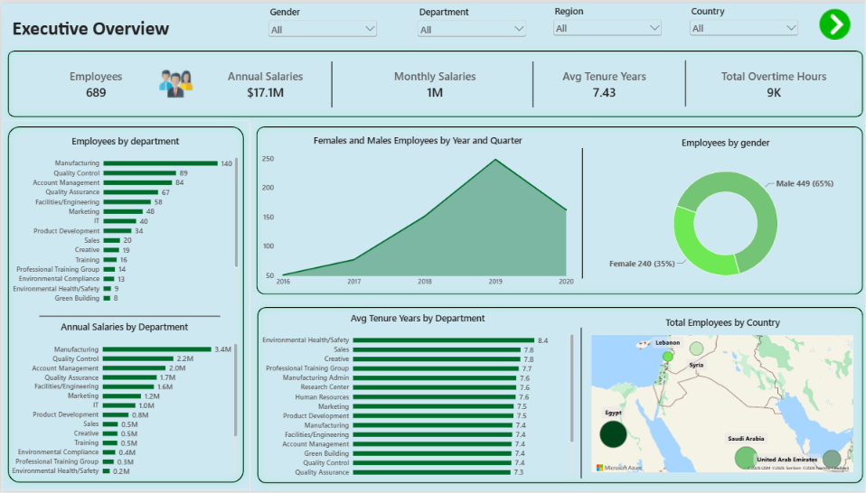
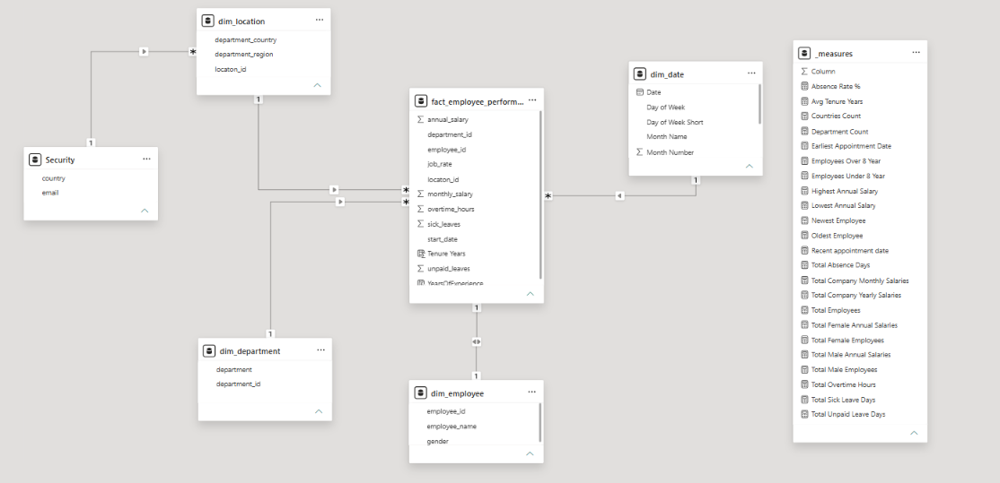
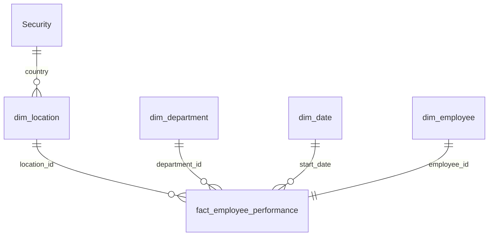
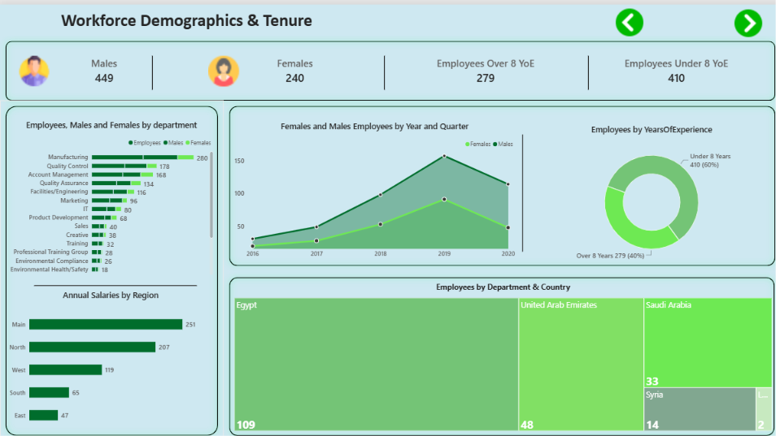
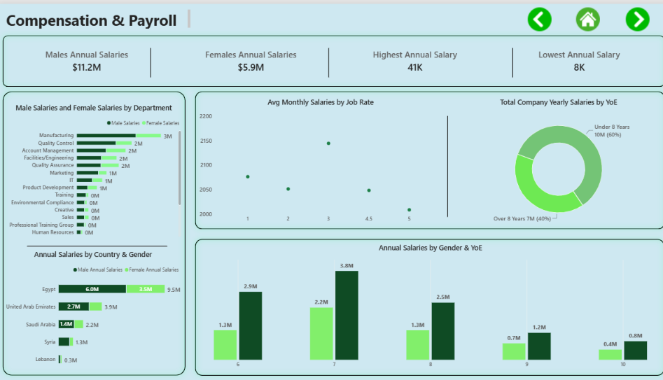
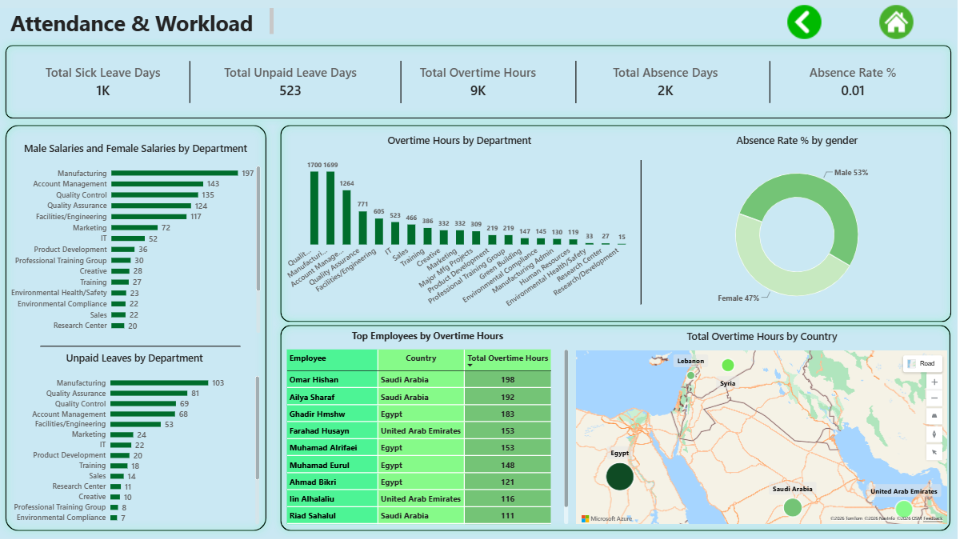

# 👥 HR Workforce Analytics | Power BI Dashboard

An interactive 4-page Power BI report that gives HR and management a clear view of **689 employees across 5 countries and 20 departments**: who they are, what they cost, and how much they work and are absent.

The report sits on a **star-schema data model that I designed and built myself**, and it is secured with **Row-Level Security (RLS)** so each manager only sees the country they are responsible for.



📄 **Full report export:** [HR_Dashboard.pdf](HR_Dashboard.pdf)

---

## 📑 Table of Contents

- [Project Overview](#-project-overview)
- [Data Model (Built by Me)](#-data-model-built-by-me)
- [Row-Level Security (RLS)](#-row-level-security-rls)
- [Key Measures](#-key-measures)
- [Source Data](#-source-data)
- [Dashboard Pages](#-dashboard-pages)
- [Key Insights](#-key-insights)
- [Tools & Techniques](#-tools--techniques)
- [Repository Structure](#-repository-structure)
- [How to Use](#-how-to-use)
- [Future Enhancements](#-future-enhancements)
- [Author](#-author)

---

## 🎯 Project Overview

HR data often lives in one wide spreadsheet, which makes it hard to slice by department, location, or time. This project turns that raw table into a clean analytical model and a multi-page report that answers questions such as:

- How big is the workforce, where is it located, and what does it cost?
- Who are our employees, and how long have they been with us?
- Is pay consistent across genders, departments, and countries?
- Which teams carry the most overtime and absence?
- How can each country manager see **only** their own data?

---

## 🧱 Data Model (Built by Me)

I designed the data model myself by splitting the original flat table into one **fact table**, four **dimension tables**, a **security table** for RLS, and a dedicated **measures table**. It follows a **star schema**, which keeps the model fast, easy to filter, and easy to extend.





### Tables

| Table | Type | Key Columns | Purpose |
|-------|------|-------------|---------|
| **fact_employee_performance** | Fact | employee_id, department_id, location_id, start_date | Salary, job rate, overtime, leave, and tenure values, one row per employee |
| **dim_employee** | Dimension | employee_id, employee_name, gender | Employee attributes |
| **dim_department** | Dimension | department_id, department | Department lookup |
| **dim_location** | Dimension | location_id, department_country, department_region | Country and region of each location |
| **dim_date** | Dimension | Date, Day of Week, Day of Week Short, Month Name, Month Number | Calendar table for hiring trends |
| **Security** | Security | country, email | Maps each user to the country they may see (RLS) |
| **_measures** | Measures | none | Holds all DAX measures in one place |

### Fact table columns

`annual_salary` · `monthly_salary` · `job_rate` · `overtime_hours` · `sick_leaves` · `unpaid_leaves` · `start_date` · `Tenure Years` · `YearsOfExperience`

### Relationships

| From | To | Cardinality | Filter direction |
|------|----|-------------|------------------|
| Security → dim_location | country | One-to-many | Single |
| dim_location → fact | location_id | One-to-many | Single |
| dim_department → fact | department_id | One-to-many | Single |
| dim_date → fact | start_date | One-to-many | Single |
| dim_employee ↔ fact | employee_id | One-to-one | Both |

### Why this design

- **Star schema:** each dimension filters the fact table directly, so slicers and cross-filtering behave predictably.
- **Separate dimensions:** department, location, and employee details are stored once instead of being repeated on every row.
- **Dedicated date table:** enables hiring trends by year and quarter.
- **Calculated columns:** `Tenure Years` and `YearsOfExperience` are derived in the model rather than stored in the source.
- **Measures table:** all DAX lives in `_measures`, which keeps the field list clean and measures easy to find.

---

## 🔐 Row-Level Security (RLS)

Different country managers should not see each other's employees or salaries. I added a **Security** table and a role so the same report shows each user only their own country.

### How it works

1. The **Security** table holds one row per user–country pair (`country`, `email`).
2. It is related one-to-many to `dim_location`, matching on country.
3. A role filters the table to the signed-in user:
   ```DAX
   [email] = USERPRINCIPALNAME()
   ```
4. The filter flows **Security → dim_location → fact table (→ dim_employee)**, so every KPI, chart, and map recalculates for that user's country only.

### Testing and deploying

- **Test in Desktop:** *Modeling → View as* → select the role and enter a test email.
- **Deploy:** publish to the Power BI Service, open the semantic model's **Security** settings, and add users or groups to the role.
- **Good to know:** RLS applies to workspace **Viewers**. Workspace Admins, Members, and Contributors can see all data.
- **Tip:** hide the Security table from report view, and never publish real employee emails in a public repository.

---

## 🧮 Key Measures

All measures live in the `_measures` table.

| Group | Measures |
|-------|----------|
| **Headcount** | Total Employees · Total Male Employees · Total Female Employees · Employees Over 8 Year · Employees Under 8 Year · Department Count · Countries Count |
| **Payroll** | Total Company Yearly Salaries · Total Company Monthly Salaries · Total Male Annual Salaries · Total Female Annual Salaries · Highest Annual Salary · Lowest Annual Salary |
| **Tenure & dates** | Avg Tenure Years · Earliest Appointment Date · Recent Appointment Date · Oldest Employee · Newest Employee |
| **Attendance & workload** | Total Sick Leave Days · Total Unpaid Leave Days · Total Absence Days · Absence Rate % · Total Overtime Hours |

**Definitions**

| Measure | Definition |
|---------|-----------|
| Total Employees | Distinct count of `employee_id` |
| Total Company Yearly Salaries | Sum of `annual_salary` |
| Avg Tenure Years | Average of `Tenure Years` |
| Total Absence Days | Sick leave days + unpaid leave days |
| Absence Rate % | Total absence days ÷ (employees × 260 working days per year) |
| Employees Over / Under 8 Year | Employees grouped by `YearsOfExperience` (8-year threshold) |

---

## 🗂 Source Data

The model is built from one flat employee table with these fields:

| Field | Description |
|-------|-------------|
| employee_id | Unique employee identifier |
| First Name / Last Name | Employee name (combined into `employee_name`) |
| Gender | Employee gender |
| Start Date | Hire date |
| months / Years | Time since hire |
| Department | Employee's department |
| Country / Center | Work location |
| Monthly Salary / Annual Salary | Compensation |
| Job Rate | Job grade or rate |
| Sick Leaves / Unpaid Leaves | Leave days taken |
| Overtime Hours | Overtime worked |

---

## 📊 Dashboard Pages

The report has four pages, linked by back, home, and next navigation buttons. Each page answers one business question.

### 1️⃣ Executive Overview
*How big is the workforce, where is it, and what does it cost?*


- **Slicers:** Gender, Department, Region, Country
- **KPIs:** Employees (**689**) · Annual Salaries (**$17.1M**) · Monthly Salaries · Avg Tenure Years (**7.43**) · Total Overtime Hours (**~9K**)
- **Visuals:** Employees by department · Annual salaries by department · Employees by year and quarter · Employees by gender · Avg tenure years by department · Total employees by country (map)

### 2️⃣ Workforce Demographics & Tenure
*Who are the employees, and how experienced and stable is the workforce?*



- **KPIs:** Males (**449**) · Females (**240**) · Employees over 8 years of experience (**279**) · Employees under 8 years (**410**)
- **Visuals:** Males and females by department · Employees by region · Males and females by year and quarter · Employees by years of experience · Employees by department and country (treemap)

### 3️⃣ Compensation & Payroll
*How much are employees paid, and is pay consistent?*



- **KPIs:** Males annual salaries (**$11.2M**) · Females annual salaries (**$5.9M**) · Highest annual salary (**41K**) · Lowest annual salary (**8K**)
- **Visuals:** Male and female salaries by department · Annual salaries by country and gender · Avg monthly salary by job rate · Total yearly salaries by experience · Annual salaries by gender and years of experience

### 4️⃣ Attendance & Workload
*Which teams carry the most overtime and absence?*



- **KPIs:** Sick leave days (**~1K**) · Unpaid leave days (**523**) · Overtime hours (**~9K**) · Absence days (**~2K**) · Absence rate %
- **Visuals:** Sick leave days by department · Unpaid leaves by department · Overtime hours by department · Absence rate by gender · Top employees by overtime (table) · Overtime hours by country (map)

---

## 🔍 Key Insights

**Workforce**
- The company has **689 employees** and a **$17.1M** annual payroll, about **$24.8K per employee**.
- The workforce is **65% male (449) and 35% female (240)**.
- **Manufacturing** is the largest department (140 employees, **$3.4M** payroll). The top three departments (Manufacturing, Quality Control, Account Management) make up about **45%** of all staff.
- Headcount by region: Main (251), North (207), West (119), South (65), East (47).

**Hiring and tenure**
- Hiring grew every year from about 50 in 2016 to a **peak of about 250 in 2019**, then fell to about 165 in 2020.
- Average tenure is **7.43 years**. **Environmental Health/Safety** is the most experienced team (8.4 years), followed by Sales and Creative (7.8).
- **60%** of employees (410) have under 8 years of experience and **40%** (279) have over 8.

**Compensation**
- Males account for $11.2M and females for $5.9M of payroll, but this mirrors the headcount split. Average annual pay per person is **roughly equal** (about $24.9K for males and $24.6K for females, from rounded totals).
- **Egypt** holds the largest share of payroll (**$9.5M, about 56%**), followed by the UAE ($3.9M), Saudi Arabia ($2.2M), Syria ($1.3M), and Lebanon ($0.3M).
- Annual salaries range from **8K to 41K**.
- Average monthly salary stays within a narrow band (about 2,000 to 2,150) across job rates 1 to 5, peaking at job rate 3, so job rate has little visible link to pay.

**Workload and absence**
- **Quality Control (1,700 hours)** and **Manufacturing (1,699 hours)** lead overtime, followed by Account Management (1,264).
- **Manufacturing** also records the most sick leave days (197) and unpaid leave days (103).
- The employee with the most overtime logged **198 hours**.
- Total absence is about 2K days, which is roughly **1%** of available working days.

---

## 🛠 Tools & Techniques

- **Power BI Desktop:** report design, interactivity, and map visuals
- **Data modelling:** star schema, fact and dimension tables, relationships
- **Row-Level Security:** `USERPRINCIPALNAME()` role over a Security table
- **DAX:** KPI measures and calculated columns, organised in a `_measures` table
- **Power Query:** cleaning and reshaping the source table
- **Navigation:** back, home, and next buttons across pages

---

## 📁 Repository Structure

```
HR-Workforce-Analytics/
│
├── 📄 README.md
├── 📄 HR_Dashboard.pdf                      # Full report export
├── 📊 HR_Workforce_Analytics.pbix           # Power BI report with data model and RLS
├── 📂 data/
│   └── employees.csv                        # Source data (anonymized)
└── 📂 images/
    ├── data_model.png
    ├── page1_executive_overview.png
    ├── page2_demographics_tenure.png
    ├── page3_compensation_payroll.png
    └── page4_attendance_workload.png
```

> Adjust file and folder names to match your actual project files.

---

## ▶️ How to Use

1. **Clone** the repository:
   ```bash
   git clone https://github.com/Aminsfwt/HR-Workforce-Analytics.git
   ```
2. Install **Power BI Desktop** (free, Windows).
3. Open the `.pbix` file.
4. If prompted, update the data source path (*Home → Transform data → Data source settings*).
5. Use the slicers on the Executive Overview page and click any visual to cross-filter the report.
6. To see RLS in action, go to *Modeling → View as* and pick the role.

> 🔒 **Privacy note:** employee names (such as the Top Employees table) and the emails in the Security table should be removed or anonymized before publishing publicly.

---

## 🚀 Future Enhancements

- Add an **Employee Detail** drill-through page for individual lookups.
- Add an **Estimated Overtime Cost** measure (hourly rate × overtime hours × premium) by department.
- Add **leave and overtime per employee** to compare departments of different sizes fairly.
- Add a **Gender Pay Gap %** KPI.

---

## 👤 Author

**Amin Safout Ali**, BI Data Analyst
- LinkedIn: [linkedin.com/in/aminsafoutali](https://linkedin.com/in/aminsafoutali)
- GitHub: [github.com/Aminsfwt](https://github.com/Aminsfwt)
- Power BI Service: [HR Dashboard](https://app.powerbi.com/reportEmbed?reportId=72a6e13d-969b-4131-9690-c2aea0bb2219&autoAuth=true&ctid=3789c9f7-c841-4c22-af5a-491da9991d86)

---

⭐ If you found this project useful, please give it a star!
